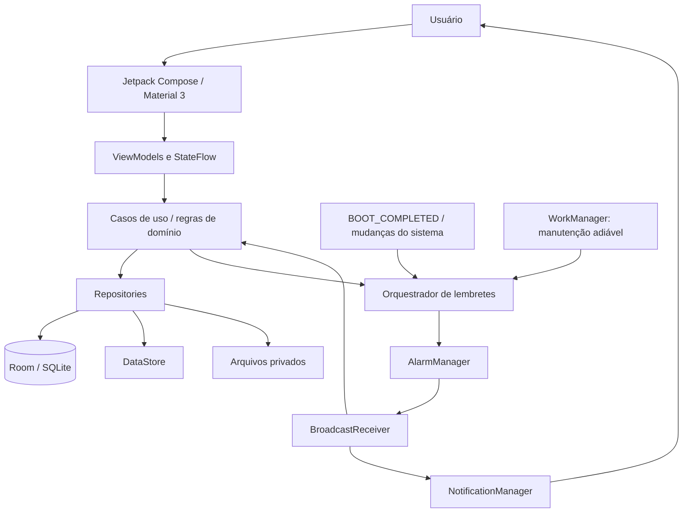
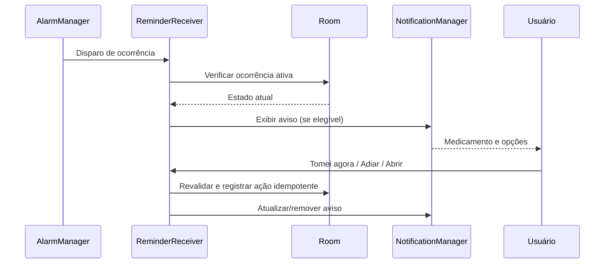

# Arquitetura — Remédio Hora Certa

**Estado:** arquitetura proposta, ainda não implementada.  
**Última revisão:** 2026-11-10.  
**Escopo:** aplicativo Android local e offline, com persistência de tratamentos, agendamento de lembretes e histórico de confirmações.

## 1. Objetivos arquiteturais

1. **Confiabilidade:** lembretes agendados a partir do estado persistido, com reconciliação após mudanças relevantes.
2. **Integridade clínica do registro:** não confundir alarme entregue com medicamento efetivamente tomado.
3. **Operação offline:** não depender de conta, servidor ou API de terceiros nas funções centrais.
4. **Acessibilidade:** fluxo simples para usuários idosos e com dificuldades de atenção.
5. **Manutenibilidade:** separação entre interface, regras de domínio e infraestrutura Android.
6. **Segurança por padrão:** arquivos privados, permissões mínimas e minimização de dados.

Não se busca automatizar decisões médicas. Dosagem e agenda são sempre dados introduzidos e confirmados pelo usuário.

## 2. Visão de alto nível



**Princípio:** o banco de dados é a fonte de verdade. Alarmes do sistema são uma projeção temporária do cronograma salvo, não a única cópia dos horários.

## 3. Pilha tecnológica

- **Kotlin** para domínio e integração com Android.
- **Jetpack Compose** para interface declarativa; **Material 3** para componentes e tema.
- **MVVM** por funcionalidade, com `ViewModel`, `StateFlow` e estados de tela imutáveis.
- **Use cases** para regras como salvar tratamento, gerar ocorrências e confirmar dose.
- **Room/SQLite** para histórico e relacionamentos; **DataStore** para preferências.
- **Coroutines** para operações de I/O e processamento assíncrono.
- **Navigation Compose** para rotas.
- **Hilt** somente se a complexidade justificar; avaliar antes de incluir.
- **AlarmManager** para lembretes sensíveis a horário, conforme permissões do dispositivo.
- **NotificationManager** para avisos e ações explícitas.
- **WorkManager** apenas para manutenção/reconciliação adiável, nunca como garantia de horário exato.
- **Photo Picker** e **Storage Access Framework** para entrada de imagens e PDFs.

### Fluxo de dependências

`ui -> domain -> contratos de repository <- implementações data/infra`.

A interface não acessa Room diretamente e as entidades Room não devem ser expostas como estados de tela. Regras de dose, período e recorrência devem ser testáveis sem Android UI.

## 4. Estrutura proposta de pacotes

```text
app/src/main/java/<package>/
├── MainActivity.kt
├── RemedioHoraCertaApp.kt
├── core/
│   ├── time/                 # Clock, fuso, regras DST e datas
│   ├── result/               # tipos de erro/resultado
│   ├── accessibility/        # utilitários de acessibilidade
│   └── security/             # acesso privado e proteção de dados
├── data/
│   ├── local/
│   │   ├── AppDatabase.kt
│   │   ├── dao/
│   │   ├── entity/
│   │   └── migration/
│   ├── preferences/
│   ├── files/
│   └── repository/
├── domain/
│   ├── model/
│   ├── repository/           # interfaces
│   ├── schedule/             # geração e validação da agenda
│   └── usecase/
├── feature/
│   ├── today/
│   ├── medication/
│   ├── treatment/
│   ├── history/
│   ├── attachments/
│   └── settings/
├── reminder/
│   ├── AlarmScheduler.kt
│   ├── ReminderReceiver.kt
│   ├── RescheduleReceiver.kt
│   ├── NotificationFactory.kt
│   └── ReminderReconciler.kt
├── di/
└── ui/theme/
```

Nomes e diretórios são uma proposta; podem mudar, desde que o README e este documento sejam atualizados.

## 5. Responsabilidades por camada

### UI e ViewModels

- Exibir as informações relevantes, não decidir posologias.
- Formulários com validação de entrada, mensagens curtas e prevenção de toques duplos.
- Observar `StateFlow` e reconstruir a tela a partir de estado persistido.
- Exibir diferença entre **tomado**, **não tomado**, **pendente** e **atrasado sem confirmação**.
- Solicitar permissões apenas em contexto, com explicação apropriada.

### Domínio

Casos de uso sugeridos:

| Caso de uso | Responsabilidade |
|---|---|
| `CreateMedication` | validar e gravar cadastro |
| `SaveTreatmentSchedule` | validar vigência e regras de horários |
| `GenerateDoseOccurrences` | projetar próximas doses de forma determinística |
| `ReconcileReminders` | cancelar alarmes obsoletos e reagendar os válidos |
| `ConfirmDoseTaken` | confirmar uma ocorrência explicitamente, de modo idempotente |
| `MarkDoseNotTaken` | registrar declaração explícita de não tomada |
| `SnoozeReminder` | adiar apenas o aviso, sem alterar o tratamento |
| `ImportAttachment` | validar o anexo e copiá-lo para armazenamento privado |
| `PauseTreatment` | impedir novos alarmes mantendo o histórico |

### Persistência

- Salvar medicamentos, tratamentos, horários e ocorrências em transações quando necessário.
- Fornecer histórico auditável e preservar dados passados durante edições.
- Não usar `fallbackToDestructiveMigration()` em produção.
- Manter migrações versionadas e testadas.
- Não guardar receitas completas como blobs no SQLite; manter apenas referências a arquivos privados.

## 6. Agendamento de doses e notificações

### 6.1 Tipos de agenda

**Horários fixos:** o usuário escolhe horários locais (por exemplo, 08:00 e 20:00) e dias da semana. A intenção é manter o horário civil local de cada dia válido.

**Intervalos:** o usuário fornece explicitamente um intervalo prescrito e um instante de referência. A intenção é preservar o intervalo entre instantes, inclusive ao atravessar meia-noite, sujeito aos limites do tratamento. Não deduzir automaticamente duração ou intervalo a partir de nomes de medicamentos.

Esses modos são mutuamente exclusivos por regra de agenda, e uma mudança de modo exige confirmação.

### 6.2 Representação temporal

- Persistir datas de início/fim como `LocalDate` em formato ISO, quando representarem dias civis.
- Persistir horários diários como `LocalTime` em formato `HH:mm`.
- Persistir instantes de disparo e confirmação em UTC (`Instant`, convertido para epoch millis no banco).
- Definir política explícita de fuso: **proposta para o MVP**: horários fixos acompanham o fuso local atual do dispositivo; intervalos seguem a linha temporal a partir do instante inicial. Avisar o usuário ao detectar mudança de fuso.
- Definir e testar comportamento em horários inexistentes/ambíguos durante mudanças de horário de verão, quando aplicável. Não gerar silenciosamente duas doses para o mesmo horário civil.

### 6.3 Algoritmo de reconciliação

```text
1. Ler medicamentos e agendas ativos no Room.
2. Verificar permissões e capacidade de agendamento no dispositivo.
3. Calcular próximas ocorrências válidas em uma janela limitada.
4. Persistir/reconciliar ocorrências, mantendo registros históricos existentes.
5. Cancelar somente PendingIntents associados a alarmes obsoletos.
6. Agendar próximos lembretes elegíveis com identificadores únicos.
7. Registrar apenas metadados técnicos não sensíveis para diagnóstico.
8. Reexecutar quando houver cadastro, edição, pausa, retomada,
   reinicialização, alteração de fuso/horário e mudança de permissões.
```

Pode-se começar agendando apenas o próximo lembrete por agenda e, depois de cada disparo, agendar o seguinte. O algoritmo precisa ser idempotente para tolerar execução repetida e mortes de processo. O horizonte exato, o total de alarmes e as políticas de reentrega deverão ser definidos após testes.

### 6.4 Permissões e restrições Android

- Para Android 13+, tratar `POST_NOTIFICATIONS` ao exibir notificações comuns.
- Para alarmes exatos nas versões relevantes, avaliar a necessidade de `SCHEDULE_EXACT_ALARM`, consultar `canScheduleExactAlarms()` e direcionar o usuário ao ajuste do sistema quando necessário.
- **Não declarar `USE_EXACT_ALARM` automaticamente**: a permissão tem casos de uso limitados e deve ser avaliada frente às regras vigentes de distribuição.
- Considerar `setExactAndAllowWhileIdle()` somente quando o caso realmente exigir e a permissão permitir; isso **não garante** entrega absoluta em todos os fabricantes e condições.
- Agendar novamente após `BOOT_COMPLETED`, quando o armazenamento do usuário estiver disponível, e após mudanças da permissão especial.
- Em revogação da permissão de alarme exato, informar a limitação e manter a agenda no banco; não afirmar que o lembrete continua pontual.
- Evitar disparos de `WorkManager` como mecanismo central de lembretes pontuais.

Documentação oficial: https://developer.android.com/develop/background-work/services/alarms

### 6.5 Fluxo da notificação



**Regra de segurança:** a entrega, visualização, dispensa ou adiamento de uma notificação **nunca** confirma a administração. A confirmação precisa resultar de uma escolha explícita do usuário.

**Proteção contra duplicidade:** usar identificação estável da ocorrência + ação, `PendingIntent` exclusivo por ocorrência (com flags adequadas) e restrições de unicidade no banco. Validar intenção e estado antes de qualquer gravação. Uma confirmação repetida não deve produzir dois eventos.

### 6.6 Lembrete adiado

- `Lembrar depois` cria um novo aviso da **mesma ocorrência** após o intervalo escolhido.
- Não gera uma nova dose e não altera a posologia.
- Se a próxima dose estiver próxima ou houver conflito, a interface deve alertar que o adiamento não muda a orientação prescrita.
- Limitar e tornar configurável a quantidade de repetições para evitar sobrecarga de notificações.

## 7. Fotos, receitas e armazenamento

1. Solicitar a seleção por Photo Picker ou Storage Access Framework.
2. Validar MIME real quando possível, extensão, tamanho, disponibilidade e erros de leitura.
3. Copiar o conteúdo validado para diretório privado com identificador aleatório e nome não sensível.
4. Persistir no banco apenas ID, tipo, tamanho e referência interna.
5. Mostrar arquivos por acesso controlado; não publicar um caminho `file://` indiscriminadamente.
6. Na exclusão, tratar metadados e arquivo em operação consistente, com recuperação de falhas prevista.
7. Não armazenar URI temporária como único meio de acesso para sempre.

Na captura com câmera, usar integração segura com `FileProvider` e permissões mínimas. Avaliar proteção adicional em repouso com Android Keystore e criptografia autenticada para anexos, considerando portabilidade e recuperação de chaves.

## 8. Acessibilidade como requisito transversal

- Elementos interativos com tamanho adequado de toque e rótulo acessível.
- Suporte a escala de fonte do Android sem truncar conteúdo crítico.
- Contraste e informação não dependentes somente de cor.
- Navegação por leitor de tela e ordem de foco coerente.
- Fluxo principal de confirmação executável com poucos gestos.
- Modo Simplificado, sem ocultar a identificação do medicamento e da dose.
- Linguagem neutra: usar **Não confirmado** em vez de presumir falha ou culpa.

## 9. Falhas e casos críticos

| Situação | Comportamento esperado |
|---|---|
| Permissão de notificação negada | Exibir diagnóstico e orientar como habilitar; não fingir que notificou |
| Permissão de alarme exato negada | Informar limitação e não prometer pontualidade |
| Reinício do aparelho | Reconciliar alarmes a partir da base persistida |
| Fuso/horário alterado | Recalcular horários fixos conforme política documentada |
| Tratamento pausado/excluído | Cancelar avisos futuros; preservar histórico conforme política |
| App aberto em dois fluxos simultâneos | Garantir transações/idempotência por ocorrência |
| Anexo corrompido ou ausente | Exibir erro recuperável sem interromper o cadastro |
| Notificação tocada após mudança da agenda | Revalidar ocorrência antes de confirmar |
| Armazenamento cheio | Evitar gravação parcial e orientar o usuário |

## 10. Política de evolução

- Qualquer mudança que afete estados clínicos, cálculo de dose ou agendamento exige testes de regressão.
- Toda mudança no schema exige migração, atualização de `DATABASE.md` e testes de preservação do histórico.
- Revisar política de privacidade antes de incluir analytics, rede, exportação ou cuidador.
- Documentar decisões relevantes com justificativa no PR/commit ou em futura pasta de decisões arquiteturais.

## Referências

- AlarmManager: https://developer.android.com/develop/background-work/services/alarms
- WorkManager: https://developer.android.com/develop/background-work/background-tasks/persistent
- Photo Picker: https://developer.android.com/training/data-storage/shared/photo-picker
- Documentos: https://developer.android.com/guide/topics/providers/document-provider
- Regras de backup: https://developer.android.com/identity/data/autobackup

---

*Documento de projeto. Não constitui evidência de implementação ou de testes realizados.*
