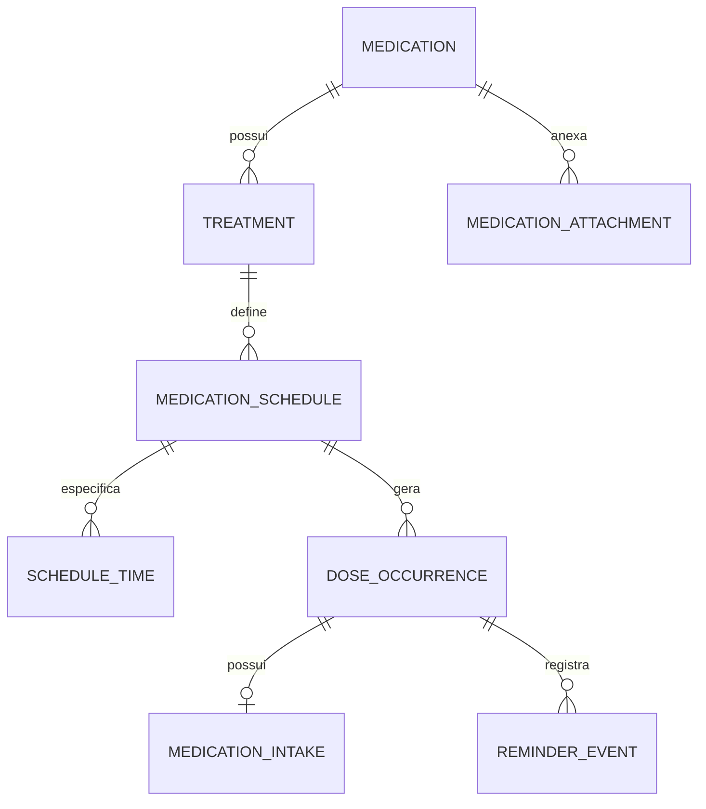

# Modelo de dados — Remédio Hora Certa

**Estado:** proposta de schema para Room/SQLite, **não implementada nem migrada**.  
**Revisão:** 2026-11-10.  
**Objetivo:** preservar cadastro, agenda, eventos de doses, anexos e configurações, sem inferências clínicas.

## 1. Diretrizes de modelagem

- Banco local SQLite gerenciado por **Room**.
- Identificadores UUID (`TEXT`) gerados no aplicativo, não números de telefone ou dados pessoais.
- Datas civis em ISO `YYYY-MM-DD` e horários civis em `HH:mm`; instantes em epoch milliseconds UTC (`INTEGER`).
- Integridade referencial com chaves estrangeiras e índices.
- Atualizações relacionadas devem ocorrer em transações.
- **Não apagar registros de doses administradas** ao editar um cronograma.
- `atrasado` é uma condição calculada (horário passou e não houve confirmação), não prova de que a dose não foi tomada.
- `adiado` descreve o **lembrete**, não a administração do medicamento.
- Anexos ficam em armazenamento privado; o banco conserva seus metadados.
- Estados e enumerações são exemplos propostos e deverão ser consolidados antes da primeira migração.

## 2. Diagrama lógico



`UserPreferences` é persistido em DataStore, não obrigatoriamente em uma tabela relacional.

## 3. Entidades e campos

### 3.1 `Medication` — cadastro do medicamento

| Campo | Tipo lógico | Observação |
|---|---|---|
| `id` | UUID/TEXT | PK |
| `name` | TEXT | obrigatório, não vazio |
| `strengthLabel` | TEXT? | concentração/apresentação, ex.: `500 mg` |
| `doseQuantityLabel` | TEXT? | quantidade por administração, ex.: `1 comprimido` |
| `formulation` | TEXT? | comprimido, cápsula, gotas etc. |
| `route` | TEXT? | via, quando informada |
| `instructions` | TEXT? | texto fornecido pelo usuário |
| `notes` | TEXT? | anotações opcionais |
| `lifecycleStatus` | TEXT | `ACTIVE`, `PAUSED`, `ARCHIVED` |
| `createdAt` | INTEGER | epoch UTC |
| `updatedAt` | INTEGER | epoch UTC |

Não deduzir dose efetiva de `strengthLabel`: `500 mg` é concentração/apresentação, não equivale necessariamente à quantidade de unidades a tomar.

### 3.2 `Treatment` — duração e estado do tratamento

| Campo | Tipo lógico | Observação |
|---|---|---|
| `id` | UUID/TEXT | PK |
| `medicationId` | UUID/TEXT | FK para `Medication` |
| `kind` | TEXT | `CONTINUOUS` ou `DATED` |
| `startDate` | TEXT | `YYYY-MM-DD`, obrigatório |
| `endDate` | TEXT? | obrigatório para `DATED`; nulo para `CONTINUOUS` |
| `status` | TEXT | `ACTIVE`, `PAUSED`, `ENDED` |
| `createdAt` | INTEGER | epoch UTC |
| `updatedAt` | INTEGER | epoch UTC |

**Regra:** em `DATED`, `endDate >= startDate`; nenhuma ocorrência programada é elegível fora do período, incluindo o dia final apenas nos horários válidos.

Modelar `Treatment` separadamente permite manter episódios históricos de tratamento para um mesmo medicamento sem sobrescrever a vigência anterior.

### 3.3 `MedicationSchedule` — regra de recorrência

| Campo | Tipo lógico | Observação |
|---|---|---|
| `id` | UUID/TEXT | PK |
| `treatmentId` | UUID/TEXT | FK para `Treatment` |
| `mode` | TEXT | `FIXED_TIMES` ou `INTERVAL` |
| `weekdaysMask` | INTEGER? | bits para dias de segunda a domingo no modo fixo |
| `intervalMinutes` | INTEGER? | positivo, apenas no modo intervalo |
| `anchorInstant` | INTEGER? | instante UTC inicial do intervalo |
| `revision` | INTEGER | inicia em 1; incrementa ao mudar regra |
| `enabled` | BOOLEAN/INTEGER | agenda ativa |
| `createdAt` | INTEGER | epoch UTC |
| `updatedAt` | INTEGER | epoch UTC |

**Restrições:** `FIXED_TIMES` utiliza horários da tabela `ScheduleTime`; `INTERVAL` requer `intervalMinutes > 0` e `anchorInstant` definido. No modo fixo, a ausência de dias explicitamente selecionados deve ser validada antes de persistir.

**Semântica:** horário fixo segue horário civil; intervalo segue tempo transcorrido. Modificações de fuso devem ser tratadas como descrito em [ARCHITECTURE.md](ARCHITECTURE.md).

### 3.4 `ScheduleTime` — horários de agendas fixas

| Campo | Tipo lógico | Observação |
|---|---|---|
| `id` | UUID/TEXT | PK |
| `scheduleId` | UUID/TEXT | FK para `MedicationSchedule` |
| `localTime` | TEXT | `HH:mm` |
| `displayOrder` | INTEGER | ordenação na interface |

Criar `UNIQUE(scheduleId, localTime)`. Horários devem ser validados ao salvar; uma agenda fixa pode possuir múltiplos registros de `ScheduleTime`.

### 3.5 `DoseOccurrence` — uma dose programada

| Campo | Tipo lógico | Observação |
|---|---|---|
| `id` | UUID/TEXT | PK |
| `scheduleId` | UUID/TEXT | FK para `MedicationSchedule` |
| `scheduleRevision` | INTEGER | versão da regra de origem |
| `plannedAt` | INTEGER | instante programado UTC |
| `plannedLocalDate` | TEXT | dia previsto na visualização |
| `plannedLocalTime` | TEXT | hora local prevista |
| `timeZoneId` | TEXT | fuso utilizado no cálculo |
| `state` | TEXT | `PENDING`, `TAKEN`, `NOT_TAKEN`, `CANCELLED` |
| `createdAt` | INTEGER | epoch UTC |
| `updatedAt` | INTEGER | epoch UTC |

**Unicidade lógica:** não gerar duas vezes a mesma ocorrência para uma mesma revisão e instante; índice exclusivo em `(scheduleId, scheduleRevision, plannedAt)`.

- `PENDING`: ainda sem declaração explícita.
- `TAKEN`: usuário confirmou que tomou a dose.
- `NOT_TAKEN`: usuário afirmou expressamente que não tomou.
- `CANCELLED`: ocorrência futura invalidada por mudança de cronograma ou encerramento; não é dose perdida.

**Exibição derivada:** se `state = PENDING` e `plannedAt < agora`, apresentar **Atrasada — não confirmada**. Evitar um campo `MISSED` persistido automaticamente, pois a passagem do tempo não comprova ausência de administração.

O registro deve identificar a dose específica, mesmo que o nome/horário do medicamento mude. Para histórico imutável de exibição, considerar snapshot dos rótulos do medicamento e quantidade prevista por ocorrência, preenchido no momento da geração, ou versionamento explícito do cadastro.

### 3.6 `MedicationIntake` — declaração do usuário

| Campo | Tipo lógico | Observação |
|---|---|---|
| `id` | UUID/TEXT | PK |
| `occurrenceId` | UUID/TEXT | FK e **UNIQUE** para `DoseOccurrence` |
| `result` | TEXT | `TAKEN` ou `NOT_TAKEN` |
| `recordedAt` | INTEGER | instante UTC da ação |
| `takenAt` | INTEGER? | horário real informado/confirmado, quando `TAKEN` |
| `quantityLabelSnapshot` | TEXT? | quantidade informada na ocorrência |
| `source` | TEXT | `APP`, `NOTIFICATION`, `MANUAL_CORRECTION` |
| `note` | TEXT? | justificativa opcional |

**Invariante crítica:** uma mesma ocorrência não pode gerar duas confirmações independentes. O repositório deve usar transação para consultar estado, inserir a declaração e atualizar a ocorrência; UNIQUE impede duplicidade mesmo diante de toques concorrentes.

**Correções de histórico:** se forem permitidas, exigir ação explícita, registrar data da correção e trilha de auditoria (tabela adicional `IntakeAuditEvent`); não editar silenciosamente registros antigos.

### 3.7 `ReminderEvent` — eventos dos avisos

| Campo | Tipo lógico | Observação |
|---|---|---|
| `id` | UUID/TEXT | PK |
| `occurrenceId` | UUID/TEXT | FK para `DoseOccurrence` |
| `kind` | TEXT | `SCHEDULED`, `DELIVERED`, `SNOOZED`, `CANCELLED` |
| `eventAt` | INTEGER | epoch UTC |
| `nextReminderAt` | INTEGER? | novo aviso no caso de adiamento |
| `attempt` | INTEGER | contador limitado de repetição |

Esta tabela é operacional e não indica ingestão. A identificação do alarme poderá ser derivada da ocorrência e número da tentativa, sem guardar texto sensível no `PendingIntent`.

### 3.8 `MedicationAttachment` — anexos

| Campo | Tipo lógico | Observação |
|---|---|---|
| `id` | UUID/TEXT | PK |
| `medicationId` | UUID/TEXT | FK para `Medication` |
| `kind` | TEXT | `MEDICATION_PHOTO`, `PRESCRIPTION`, `OTHER` |
| `mimeType` | TEXT | ex.: `application/pdf`, `image/jpeg` |
| `displayName` | TEXT | nome exibido, sem caminho absoluto |
| `privateFileKey` | TEXT | ID relativo do arquivo no armazenamento privado |
| `sizeBytes` | INTEGER | validar limites e `>= 0` |
| `addedAt` | INTEGER | epoch UTC |

Não persistir o PDF/imagem como `BLOB` por padrão. Verificar conteúdo e restrições de acesso antes da importação. Evitar confiar somente no nome ou na extensão do arquivo.

### 3.9 `UserPreferences` — DataStore

Chaves propostas:

| Chave | Possíveis valores |
|---|---|
| `theme` | `SYSTEM`, `LIGHT`, `DARK` |
| `simplifiedMode` | boolean |
| `textScale` | política acessível, respeitando o sistema |
| `soundEnabled` | boolean |
| `vibrationEnabled` | boolean |
| `snoozeMinutes` | valor positivo entre limites definidos |
| `maxRepeatReminders` | inteiro não negativo e limitado |
| `hideMedicationOnLockScreen` | boolean; padrão de privacidade a definir |

Não armazenar credenciais, receitas ou conteúdo clínico em DataStore.

## 4. Regras de integridade

### Invariantes obrigatórias

1. `Medication.name` não pode ser branco.
2. `Treatment.endDate` só pode ser nulo em uso contínuo.
3. Uma ocorrência pertence a uma agenda e versão específicas.
4. O calendário futuro deve ser recalculado após edição/pausa, sem reescrever registros passados confirmados.
5. Uma ocorrência possui no máximo uma declaração vigente de administração.
6. Um aviso adiado aponta para a **mesma** ocorrência.
7. Lembrete dispensado ou expirado **não** gera declaração de `NOT_TAKEN`.
8. A exclusão de anexos deve alcançar metadados e arquivo privado, com estratégia de recuperação.
9. A remoção de medicamento não pode apagar inadvertidamente histórico médico; preferir arquivamento e política explícita de exclusão de dados.
10. Identificadores de `PendingIntent` e notificações precisam ser únicos, determinísticos ou corretamente registrados para cancelamento.

### Política de exclusão

**Arquivamento:** retirar medicamento dos cadastros ativos e cancelar próximos avisos; preservar histórico e anexos conforme decisão do usuário.

**Excluir dados permanentemente:** ação separada, com confirmação e indicação do que será apagado. Se houver exigência de exclusão total, usar transação/rotina explícita e limpar anexos correspondentes. Não misturar arquivamento com destruição automática de histórico.

### Índices sugeridos

```sql
CREATE INDEX idx_treatment_medication ON Treatment(medicationId);
CREATE INDEX idx_schedule_treatment ON MedicationSchedule(treatmentId);
CREATE UNIQUE INDEX uq_schedule_time ON ScheduleTime(scheduleId, localTime);
CREATE UNIQUE INDEX uq_occurrence ON DoseOccurrence(scheduleId, scheduleRevision, plannedAt);
CREATE INDEX idx_occurrence_planned ON DoseOccurrence(plannedAt);
CREATE UNIQUE INDEX uq_intake_occurrence ON MedicationIntake(occurrenceId);
CREATE INDEX idx_attachment_medication ON MedicationAttachment(medicationId);
CREATE INDEX idx_reminder_occurrence ON ReminderEvent(occurrenceId);
```

**Nota:** SQL conceitual, não script de migração pronto; nomes exatos e regras Room/SQLite serão confirmados na implementação.

## 5. Exemplo fictício

> Dados exclusivamente demonstrativos, não uma recomendação médica.

Medicamento de exemplo: `Medicamento A`, apresentação `500 mg`, quantidade `1 comprimido`, tratamento `CONTINUOUS`, horários `08:00` e `20:00`, todos os dias.

| Data e hora prevista | Ocorrência | Confirmação | Exibição |
|---|---|---|---|
| 2026-11-10 08:00 | `oc-001` | 08:07, `TAKEN` | Tomado às 08:07 |
| 2026-11-10 20:00 | `oc-002` | nenhuma | Pendente (ou atrasado se passou do horário) |
| 2026-11-11 08:00 | `oc-003` | nenhuma | Próxima dose |

Se `oc-002` disparar um lembrete às 20:00 e a pessoa tocar **Lembrar depois**, criar um `ReminderEvent` com próximo aviso, **sem** criar uma dose `oc-004` e **sem** gravar um `MedicationIntake`.

Se a pessoa tocar **Tomei agora** duas vezes, a operação deve resultar em **uma** confirmação associada a `oc-002`.

## 6. Migrações do banco

- Criar primeira versão do `AppDatabase` após estabilizar minimamente as entidades.
- Adicionar migrações explícitas para mudanças de coluna, relacionamentos e índices.
- Habilitar exportação do schema Room para controle de versão, sem dados de usuários.
- Realizar testes de migração preservando registros representativos.
- Proibir `fallbackToDestructiveMigration()` na versão distribuída.
- Não usar banco com dados médicos reais em fixtures compartilhadas.

## 7. Backup e recuperação

A operação offline **não implica** ausência de backup automático do Android. Revisar `android:allowBackup`, `fullBackupContent` e `dataExtractionRules` para evitar que banco, documentos e preferências sensíveis sejam transferidos sem intenção. Fazer testes em versões e fabricantes suportados.

A versão inicial deve adotar uma política **conservadora de não incluir dados médicos em backups automáticos**, até que exista um mecanismo de backup/restauração seguro e documentado. Testar a configuração, pois o comportamento de transferência entre dispositivos pode variar.

Referência: https://developer.android.com/identity/data/autobackup

## 8. Critérios de validação do schema

- [ ] CRUD das entidades e relacionamentos validado.
- [ ] Registro de confirmação duplicada rejeitado.
- [ ] Histórico preservado após edição/pausa.
- [ ] Horários e intervalos atravessando meia-noite testados.
- [ ] Tratamento com data final não gera doses posteriores.
- [ ] Migrações testadas entre versões.
- [ ] Importação/exclusão de anexos recupera falhas corretamente.
- [ ] Backup e restauração não expõem dados contra a política definida.

Itens não marcados: ainda não verificados.

---

*Este arquivo descreve decisões propostas para a implementação e deve acompanhar as migrações reais.*
